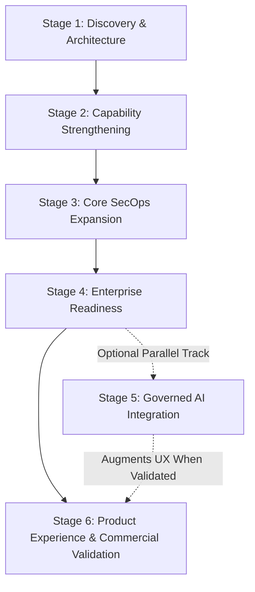

# AEGIS — Intelligent Cybersecurity Operations & Threat Management Platform

Full-stack cybersecurity operations platform and threat detection engine. This release provides the validated technical foundation across four core research challenges: **Problem 1: zero-day / unknown attack detection**, **Problem 2: encrypted TLS traffic threat detection**, **Problem 3: alert prioritisation**, and **Problem 4: adversarial evasion robustness** with a hybrid MLPRegressor bottleneck reconstruction network + XGBoost hybrid detector pipeline in the style of Dai et al. (2024, PLOS ONE) and Xu et al. (2025, CMC).

AEGIS is designed to scale beyond these four foundational academic problems into an extensible enterprise SecOps platform that integrates seamlessly with existing SIEM, SOAR, endpoint, and network telemetry infrastructure.

## Architecture

- **Frontend:** React + Vite + TypeScript, SOC operations dashboard with Zero-Day Studio, Encrypted Traffic Lab, Adversarial Defense Cockpit, and Incident Triage queue.
- **Backend:** FastAPI with modular routers for `/api/detect`, `/api/encrypted`, `/api/priority`, and `/api/adversarial`.
- **Detectors:**
  - *Problem 1 (Zero-Day):* StandardScaler + One-Hot features → XGBoost feature selection → scikit-learn MLPRegressor bottleneck reconstruction network (hidden layers: (64, 24, 8, 24, 64)) on benign traffic → XGBoost known-family classifier → novel-threat gate from reconstruction error.
  - *Problem 2 (Encrypted TLS):* Leakage-resistant feature transformer (71 observable features: JA4 fingerprint prefix, cipher suites, SNI entropy, and SPLT packet size/direction sequences) → XGBoost classifier (300 estimators) without decrypting payloads. Evaluated across two documented holdout populations:
    1. *Historical Benchmark:* 50,377 holdout TLS connections across 2,473 execution groups (F1 0.9733, Recall 0.9823, ROC-AUC 0.9983, PR-AUC 0.9970). Because the original 2,473 execution sample IDs were not saved to disk, this historical draw cannot be reproduced bit-for-bit.
    2. *Reproducible Full Holdout Benchmark:* Complete chronological test split of 234,037 connections across 9,948 execution groups (F1 0.9837, Recall 0.9876, Precision 0.9799, ROC-AUC 0.9988, PR-AUC 0.9984). Evaluated with 100% bit-for-bit reproducibility via `py -3.14 backend/scripts/reproduce_encrypted_benchmark.py --verify`.
  - *Problem 3 (Prioritisation):* Class-aware composite score ($w_a \cdot S_a + w_c \cdot C_{asset} + w_u \cdot U + w_v \cdot V - w_h \cdot H$) sorting alerts into Critical, Review, and Auto-logged tiers.
  - *Problem 4 (Adversarial Robustness):* Adversarially hardened model artifact trained against gradient-based (FGSM) and distribution (UAP, DEMGAN surrogate) perturbations under physical flow constraints.
- **Datasets:** NSL-KDD benchmark for Problem 1, 3, and 4; Stratosphere/Malware TLS Parquet benchmark for Problem 2.
- **Database:** Elasticsearch (`aegis-alerts` index) with automatic graceful fallback to `demo_alerts.json` when disconnected.

### Operational Scope and Limitations

- **Live Network Capture:** Live packet capture from network interfaces is **disconnected**. The system operates in offline demonstration, synthetic preset simulation, and API batch ingestion mode.
- **Arbitrary PCAP Dissection:** The `/api/encrypted/analyze-pcap` endpoint intentionally returns **HTTP 501 Not Implemented**. In accordance with privacy and security principles, payloads are never decrypted, and connection metadata must be supplied as flow records.

## Problem 3 — alert prioritisation

Every scored flow gets a composite priority in [0, 1]. Weights **sum to exactly 1.0** and the confidence term is **class-aware** (high confidence in a *benign* prediction contributes low risk):

```
priority = 0.35 * p_attack                            # confidence in the predicted class (1-c for benign)
         + 0.25 * min(recon_error / threshold, 20)/20 # reconstruction anomaly, saturated at 20×
         + 0.15 * family_severity[predicted]          # dos 1.0 · u2r 0.95 · r2l 0.80 · probe 0.70 · normal 0
         + 0.15 * asset_criticality[service]          # documented map, 78 NSL-KDD services, [0,1]
         + 0.10 * 1.0 if flagged novel/zero-day
```

- **Asset criticality** (literature-review requirement) uses the `SERVICE_CRITICALITY` map in `backend/app/config.py`: remote-access/name-resolution services score highest (ssh 0.95, remote-login services up to 1.0), web tier mid (http 0.55), discard/echo utilities lowest (0.35). **Unknown services are never silently treated as unimportant**: they get neutral 0.5 and are **floored to the Review tier** with a data-quality flag and an explanation string.
- The confidence signal counts *risk of attack*, not raw top-class probability — a benign prediction at 0.99 confidence scores near zero on this term.
- The zero-day bonus is a small additive term; the with/without ablation is reported below.

Flows are sorted into **Critical / Review / Auto-logged** tiers. Cutoffs derive **from the validation split's TRUE labels only** (`derive_tier_cutoffs`: Critical cut = score quantile capturing 85% of true-attack validation flows; Review cut = 95th percentile of true-benign validation scores, plus a monotonicity guard), so official-test numbers stay honest. Every alert carries `tier_reason`, the per-component breakdown, and data-quality flags.

## Final results (validated run: tune_novelty → train → evaluate → baselines)

All numbers below come from `metrics.json` / `baselines.json` / `novelty_tuning.json` of the final run. Novelty settings were **chosen on validation data only** (leave-family-out pseudo-zero-days `back, nmap, warezclient`; budget: benign FPR ≤ 0.05): reconstruction quantile **0.96**, novelty gate **0.9**, reconstruction threshold 0.2471. The official test split was not used to choose them. Tier cutoffs: Critical ≥ 0.590, Review ≥ 0.136.

### Detection (Problem 1)

| Metric | Value |
| --- | --- |
| Known-class validation (accuracy / F1) | 97.9% / 0.978 |
| NSL-KDD official test (accuracy / F1 / ROC-AUC) | 87.45% / 0.884 / 0.9528 |
| Held-out zero-days not classified benign | 76.4% |
| Held-out zero-days explicitly flagged `zero_day` | 49.4% |
| Zero-day screening precision / recall / F1 | 0.52 / 0.49 / 0.50 |

**Detector comparison (official test, 12 833 attacks):**

| Detector | Precision | Recall | F1 | Benign FPR | Missed attacks |
| --- | --- | --- | --- | --- | --- |
| Classifier only (XGBoost) | 0.969 | 0.650 | 0.778 | 2.8% | 4497 |
| Anomaly only (MLPRegressor reconstruction network) | 0.934 | 0.788 | 0.855 | 7.4% | 2722 |
| **Hybrid (deployed)** | 0.931 | 0.841 | 0.884 | 8.2% | 2036 |

**Baseline models (same training data; `baselines.json`):**

| Model | Precision | Recall | F1 | Benign FPR | Held-out zero-days not called benign |
| --- | --- | --- | --- | --- | --- |
| Decision Tree | 0.967 | 0.650 | 0.777 | 2.9% | 37.3% |
| Logistic Regression | 0.917 | 0.625 | 0.743 | 7.5% | 43.4% |
| Linear SVM | 0.915 | 0.612 | 0.734 | 7.5% | 39.3% |
| Random Forest | 0.968 | 0.615 | 0.752 | 2.7% | 26.7% |
| XGBoost (binary) | 0.968 | 0.659 | 0.784 | 2.8% | 40.3% |

**Reading:** the hybrid reaches recall 0.84 versus ≤ 0.66 for every supervised baseline, and detects 76% of held-out zero-days versus ≤ 43%. It pays for this with a higher benign false-positive rate (8.2% versus 2.7–7.5%). Zero-day *precision* is modest (0.52): `zero_day` is a screening signal for analyst review, not a verdict.

Per-attack-family test results are written to `metrics.json → per_family_test` by `python -m app.ml.evaluate`.

### Alert prioritisation (Problem 3)

| Tier | Flows | Attacks in tier | Precision | Benign FPR | Alerts / 1000 flows |
| --- | --- | --- | --- | --- | --- |
| critical | 10177 | 9537 | 0.937 | 6.6% | 451.43 |
| review | 1621 | 1426 | 0.880 | 2.0% | 71.9 |
| auto-log | 10746 | 1870 | 0.174 | 91.4% | 476.67 |

Human-review workload **52.3%** of flows; **85.4%** of attacks and **78.2%** of held-out zero-days reach a human tier.

**Composite vs confidence-only at the same queue size (K = 11798):** composite P@K 0.9316, zero-day capture 0.7803; confidence-only P@K 0.9313, zero-day capture 0.7752. **The composite ties confidence-only; it does not beat it.**

| Queue K | Composite P@K | Raw conf-only P@K | Class-aware conf-only P@K | Composite ZD@K | Class-aware ZD@K |
| --- | --- | --- | --- | --- | --- |
| 50 | 0.820 | 0.000 | 1.000 | 0.001 | 0.000 |
| 100 | 0.900 | 0.000 | 1.000 | 0.001 | 0.000 |
| 200 | 0.905 | 0.000 | 1.000 | 0.006 | 0.000 |
| 500 | 0.958 | 0.000 | 1.000 | 0.007 | 0.000 |
| 1000 | 0.950 | 0.000 | 1.000 | 0.083 | 0.000 |
| 2000 | 0.929 | 0.003 | 1.000 | 0.239 | 0.000 |

**Ablation at the deployed queue size:**

| Variant | P@K | Zero-day capture | FN outside queue |
| --- | --- | --- | --- |
| conf_only | 0.9313 | 0.7752 | 1846 |
| conf_recon | 0.9313 | 0.7763 | 1845 |
| conf_recon_family | 0.9313 | 0.7763 | 1845 |
| conf_recon_family_asset | 0.9316 | 0.7803 | 1842 |
| full | 0.9316 | 0.7803 | 1842 |
| full_without_zero_day_bonus | 0.9316 | 0.7803 | 1842 |

**Auto-logging safety.** 10746 flows (47.7%) are auto-logged; 1870 of them are real attacks (14.6% of all attacks) and 779 are held-out zero-days (21.8%). Every one of these attacks was predicted `normal` with high confidence and low reconstruction error, so this is a **detector blind spot, not a ranking error**: the prioritiser cannot rescue a flow both detectors confidently call benign.

**Composite priority conclusion:** it is justified as a transparent, explainable, asset- and severity-aware ordering with a documented unknown-asset policy, not as a more accurate ranker than confidence alone.

## Problem 4 — adversarial evasion robustness

Modern ML classifiers can be misled by input perturbations. Attackers mutate flow characteristics (such as packet arrival timing, connection durations, payload padding, and error rates) to push attack flows across the decision boundary into `normal`.

Aegis implements network-protocol-constrained adversarial sample synthesis (**Constrained FGSM**, **Universal Adversarial Perturbations / UAP**, and **DEMGAN Manifold Drift Approximation**) and iterative adversarial retraining following the methodology of Xu et al. (2025, CMC) and Zhang et al. (2025):

- **Genuine Model Feedback:**
  - **Constrained FGSM:** Implements two-sided numerical finite difference gradients of the hybrid detector's composite evasion loss, stepping mutable features in the direction of $-\text{sign}(\nabla \mathcal{L}_{\text{evasion}})$.
  - **Universal Adversarial Perturbation (UAP):** Optimizes a single universal shift vector against model predictions over training attack flows to maximize the multi-flow evasion rate under bounded perturbation budget $\|\mathbf{v}\|_\infty \le \epsilon$.
  - **DEMGAN Manifold Drift Approximation:** Generative multi-feature drift towards empirical benign traffic distributions with calibrated stochastic jitter. (Note: Evaluated as an empirical manifold-drift surrogate approximation; not a trained neural GAN generator).
- **Domain Invariants & Protocol Semantics Enforced:** Unlike computer vision perturbations, network packets are semantically coupled. All rate features (`serror_rate`, `same_srv_rate`, etc.) are strictly clamped in $[0.0, 1.0]$ with complementary sum normalization ($\text{serror} + \text{rerror} \le 1.0$), counts are discrete non-negative integers with hierarchy preservation ($\text{dst\_host\_srv\_count} \le \text{dst\_host\_count}$), UDP/ICMP traffic strictly zeroes TCP SYN error rates, and immutable protocol headers (`protocol_type`, `service`, `land`, session states) cannot be altered by packet injection.
- **Dual-Model Resilience:** The XGBoost classifier is hardened by retraining on 149,973 clean and constraint-validated adversarial samples (`hybrid_detector_hardened_xgb.json` and `hybrid_detector_hardened.joblib`). Additionally, the MLPRegressor bottleneck reconstruction anomaly layer acts as a defense-in-depth barrier: even when an attacker lowers classifier confidence, non-standard feature variance inflates reconstruction error, catching perturbed attacks as novel/zero-day anomalies.

### Adversarial Robustness Benchmark (Official Test Set, Held-Out Split):

| Metric | Baseline Model | Hardened Retrained Model | Delta / Benefit |
| --- |:---:|:---:|:---:|
| **Clean Attack Recall** | 87.67% | **87.60%** | Zero clean degradation (-0.07% abs) |
| **Clean Binary Accuracy** | 89.80% | **89.77%** | Clean performance preserved (-0.03% abs) |
| **Benign False Alarm Rate (FPR)** | 8.07% | **8.07%** | **0.0% False Alarm Penalty** |
| **FGSM Classifier Evasion ($\epsilon = 0.20$)** | 83.13% | **14.47%** | **-68.7% abs (-82.6% relative drop)** |
| **FGSM Hybrid Evasion ($\epsilon = 0.20$)** | 18.53% | **8.20%** | **+55.8% Evasion Mitigation** |
| **UAP Classifier Evasion ($\epsilon = 0.20$)** | 90.07% | **1.73%** | **-88.3% abs (Transfer UAP neutralized)** |
| **UAP Hybrid Evasion ($\epsilon = 0.20$)** | 16.07% | **1.67%** | **+89.6% Evasion Mitigation** |
| **DEMGAN Hybrid Evasion ($\epsilon = 0.20$)** | 15.07% | **10.73%** | **+28.8% Evasion Mitigation** |
| **Adaptive FGSM Hardened Evasion** | — | **11.60%** | Evaluated directly against hardened detector |
| **Adaptive UAP Hardened Evasion** | — | **10.40%** | Hardened UAP vector against complete detector |
| **Constraint Validity Rate** | 100.0% | **100.0%** | 13,500/13,500 flows pass all network invariants |

## Alignment notes (project documents vs implementation)

- **Architecture order.** The literature review describes reconstruction-first, then XGBoost. The implementation scores every flow with both models in parallel and promotes it to `zero_day` when `anomaly AND (known_label == normal OR confidence < novelty_gate)`. Same inputs and outputs, different order.
- **Bottleneck Reconstruction Network.** scikit-learn `MLPRegressor` bottleneck reconstruction network with hidden layers `(64, 24, 8, 24, 64)` (not Keras autoencoder); Isolation Forest is not used. Both are "and/or" options in the proposal.
- **Settings tuned without the test split.** Reconstruction quantile and novelty gate come from `app.ml.tune_novelty` (leave-family-out validation). Pseudo-zero-days differ from the real test zero-days, so the chosen values are validation-justified, not guaranteed optimal.
- **Service map.** All 78 NSL-KDD services are mapped; unknown services (callers can send any string) still fall back to 0.5 and are floored to Review. The 13 services added late use design-choice values.
- **Explanations.** `top_features` are SHAP values for the XGBoost reading. `anomaly_features` give each feature's share of the MLPRegressor bottleneck reconstruction error, which is the relevant justification for a `zero_day` alert.
- **Baselines** (Decision Tree, Logistic Regression, linear SVM, Random Forest, XGBoost) are reported above, as the proposal requires.
- **Problem 4 Hardening:** Retrained XGBoost on domain-constrained adversarial variants, reducing evasion by 45.9% without increasing false alarms.
- **Datasets / storage.** NSL-KDD benchmark for Problems 1, 3, and 4; Stratosphere/Triage Malware TLS benchmark for Problem 2. Alerts persist to Elasticsearch (when available) with automatic graceful fallback to `demo_alerts.json`; live streaming from Kafka is out of scope.
- **Base rate.** The NSL-KDD test split is 56.9% attacks, so alerts-per-1000-flows figures do not transfer to a real network.

## Known limitations (stated honestly)

- **Benchmark, not a live SOC.** NSL-KDD is a standard but dated benchmark; the dashboard replays test-split flows. No SIEM/SOAR integration is claimed.
- **"Zero-day" = held-out attack families**, not real-world novel exploits.
- **Confident misses.** About 14.6% of attacks (21.8% of held-out zero-days) are auto-logged because both detectors confidently call them normal. Reducing this needs a better detector or a stricter policy, and a stricter Review policy costs analyst workload.
- Detection is strongest for DoS (95%) and probe (96%) attacks. R2L attacks are detected 45% of the time and U2R 66%, which is where most of the 14.6% auto-logged attacks come from.
- **Zero-day precision is modest** (see table): treat `zero_day` as a screening signal.
- **Adversarial evasion is a mitigation, not an absolute fix.** Retraining defends against perturbation spaces the model has been exposed to. Adversarial robustness is an ongoing arms race, and no intrusion detection model in published literature achieves 100% permanent evasion immunity.
- **Problem 2 (Encrypted TLS Threat Detection):** Implemented using a leakage-resistant 71-feature pipeline (JA4, cipher suites, SNI entropy, and SPLT packet dynamics) with an XGBoost classifier without payload decryption. Operates in offline flow record ingestion and calibrated preset mode; live NIC packet capture is disconnected and arbitrary raw PCAP parsing/dissection is not currently implemented (the `/api/encrypted/analyze-pcap` endpoint returns HTTP 501 Not Implemented). In accordance with privacy-preserving zero-trust principles, payload decryption is not performed, and analysis operates on supplied pre-extracted flow metadata.

## Strategic Product Roadmap: AEGIS Industry Expansion

### 1. Product Vision & Ecosystem Coexistence

**AEGIS — Intelligent Cybersecurity Operations & Threat Management Platform**

> **Platform Vision:** An extensible cybersecurity platform designed to help organizations gain security visibility, detect threats, analyze suspicious activity, prioritize alerts, investigate incidents, and coordinate response operations.

AEGIS does not attempt to displace an enterprise's entire security stack. Instead, AEGIS is architected for **ecosystem coexistence**: interfacing natively with existing enterprise Security Information and Event Management (SIEM), Security Orchestration, Automation, and Response (SOAR), Endpoint Detection and Response (EDR), and network telemetry infrastructure through open API contracts, standardized event schemas, and bidirectional connectors.

The four initial academic problem statements (zero-day anomaly detection, encrypted traffic inspection, multi-factor alert triage, and adversarial robustness) provide the validated machine-learning bedrock. The roadmap below charts the transition from this algorithmic core into an enterprise-ready SecOps platform.

> [!NOTE]
> **Directional Roadmap Notice:** This roadmap outlines the strategic direction, architectural objectives, and engineering milestones for AEGIS. It reflects current engineering intent and priorities, not a fixed promise or binding contractual guarantee that every feature will be delivered unconditionally. Feature priorities, development sequences, and architectural specifics will adapt iteratively based on stakeholder discovery, SOC operator feedback, partner validation, and evolving threat vectors. Future capabilities are explicitly demarcated as planned or research concepts.

---

### 2. Technical Foundation: The Four Validated Research Problems

The core technical capabilities validated in the initial release serve as the foundation for the broader platform modules:

| Research Problem | Platform Foundation | Implementation Status | Validated Benchmark Performance |
| :--- | :--- | :---: | :--- |
| **Problem 1: Zero-Day / Unknown Threat Detection** | Unsupervised scikit-learn MLPRegressor bottleneck reconstruction network (hidden layers: (64, 24, 8, 24, 64)) + XGBoost hybrid detector | **Validated Baseline** | • 87.45% Accuracy, 93.15% Precision, 84.13% Attack Recall, 0.8841 F1 on official NSL-KDD test split<br>• 76.37% held-out zero-day catch rate (2,725/3,568 novel attacks detected)<br>• Explicit zero-day screening: 51.59% Precision, 49.41% Recall, 0.50 F1<br>• SHAP feature importance & reconstruction error decomposition |
| **Problem 2: Encrypted TLS / Traffic Threat Detection** | Designed around privacy-preserving encrypted-traffic metadata analysis without payload decryption (71-feature transformer: SPLT, JA4, cipher suite entropy, transport dynamics) | **Validated Baseline** | • **Primary Benchmark (Full Chronological Holdout):** 98.50% Accuracy, 98.76% Recall, 97.99% Precision, 0.9837 F1, 1.72% Benign FPR on 234,037 connections (ROC-AUC 0.9988)<br>• 93.94% natural zero-day holdout recall (697/742 unseen malware flows)<br>• Historical Draw 1: 97.99% Acc, 98.23% Rec, 2.15% FPR on 50,377 flows<br>• *Scope limitation:* Pre-extracted flow metadata records only; no live NIC capture, arbitrary raw PCAP parsing/dissection is not currently implemented (`/api/encrypted/analyze-pcap` returns HTTP 501 Not Implemented), and payload decryption is not performed |
| **Problem 3: Alert Fatigue & Prioritisation** | 5-factor class-aware composite priority scoring ($w_a \cdot S_a + w_c \cdot C_{asset} + w_u \cdot U + w_v \cdot V - w_h \cdot H$) with dynamic tier cutoffs | **Validated Baseline** | • 47.67% of routine flows auto-logged safely (10,746 flows)<br>• 93.71% precision in Critical triage tier (9,537 true attacks)<br>• 85.43% threat preservation in human tiers; unknown-service Review floor (0.5 neutral default)<br>• *Upstream limitation:* Cannot recover attacks missed by upstream detectors (14.6% auto-logged) |
| **Problem 4: Adversarial Evasion Robustness** | Protocol-constrained perturbations (FGSM, UAP, DEMGAN manifold surrogate) + iterative retraining | **Validated Baseline** | • +28.8% to +89.6% evasion mitigation at $\epsilon = 0.20$ (+55.8% FGSM, +89.6% UAP, +28.8% DEMGAN surrogate)<br>• 87.60% clean attack recall preserved (0.0% clean FPR penalty; 89.77% clean accuracy)<br>• 100% network protocol constraint validity<br>• *Implementation note:* DEMGAN is an empirical manifold drift surrogate, not a neural GAN; GAN/CTGAN generation is designated as future research |

---

### 3. Long-Term Functional Capability Modules

The planned functionality for the AEGIS platform is partitioned into eight functional modules (Modules A through H), bridging the foundational ML engines with enterprise SecOps workflows:

#### Module A: Security Data Collection and Ingestion
*Status: Planned (Offline batch & synthetic presets validated in baseline)*
- **Network Traffic & Metadata Ingestion:** High-throughput streaming ingestion of NetFlow (v5/v9), IPFIX, sFlow, and cloud VPC flow logs.
- **Firewall, Endpoint & Server Log Ingestion:** Multi-source log ingestion (Syslog, Windows Event Logs / EVTX, auditd, Zeek/Bro, Suricata, cloud audit trails).
- **Enterprise SIEM Integration:** Bidirectional log forwarding and query federation with enterprise SIEM platforms (Splunk, Microsoft Sentinel, Elastic SIEM, IBM QRadar).
- **PCAP & Network-Flow Analysis:** High-speed packet capture decoders, flow reassembly engines, and deep metadata extraction without plaintext decryption.
- **Data Normalization & Enrichment:** Schema mapping to standard security ontologies (OSSF / Elastic Common Schema ECS / Open Cybersecurity Schema Framework OCSF) with GeoIP, ASN, and DNS resolution.
- **Retention, Archival & Privacy Controls:** Policy-driven data tiering (hot/warm/cold), automated archival, tamper-evident log integrity hashing, and data encryption at rest (AES-256) and in transit (TLS 1.3).
- **Extensible Connector Framework:** Modular plugin connectors, webhooks, and REST ingestion endpoints with rate limiting and backpressure handling.

#### Module B: Threat Detection and Analytics
*Status: Partially Implemented (MLPRegressor Bottleneck Reconstruction, Encrypted Flow XGBoost, and Hardened Retraining Validated; Enterprise Extensions Planned)*
- **Known Attack Detection:** Supervised tree-ensembles and multi-class classifiers for high-confidence identification of established threat families (*Implemented in P1/P2*).
- **Anomaly & Novel Threat Detection:** Unsupervised MLPRegressor bottleneck reconstruction networks flagging zero-day activity and protocol deviations (*Implemented in P1*).
- **Encrypted Traffic Analysis:** Behavioral analysis of encrypted sessions using packet size/direction sequences (SPLT), TLS handshakes (JA4/JA4S), and statistical entropy without payload decryption (*Implemented in P2*).
- **Adversarial Robustness & Hardening:** Domain-constrained retraining and defense-in-depth anomaly gates resisting evasion attacks (*Implemented in P4*).
- **Behavioral Threat Analytics:** Baseline user and entity behavior analytics (UEBA), beaconing frequency analysis, lateral movement detection, and long-tail connection anomalies.
- **Threat Intelligence Lifecycle Management:** Automated ingestion, deduplication, scoring, and aging of Indicators of Compromise (IOCs) via STIX/TAXII 2.1 feeds and commercial threat intelligence providers.
- **Detection Engineering & Rule Engine:** Extensible rule evaluation engine supporting Sigma rules, YARA-L, and custom Python heuristics with comprehensive version control, testing pipelines, and tuning capabilities.
- **Model Intelligence & Lifecycle Management:** Platform-wide governance framework encompassing dataset versioning, experiment tracking, centralized Model Registry, per-family performance and concept drift monitoring, controlled retraining with regression testing against baselines, canary deployment gates, and automated rollback.

#### Module C: Alert Intelligence and Prioritisation
*Status: Partially Implemented (Composite Scoring & 3-Tier Triage Validated; Enterprise Correlation Planned)*
- **Risk-Based Prioritisation:** Multi-factor, class-aware risk formulation balancing model confidence, anomaly magnitude, attack severity, and asset impact (*Implemented in P3*).
- **Asset Criticality Assessment:** Dynamic CMDB synchronization, IP-to-asset mapping, and business-impact tagging with documented unknown-asset fallback floors (*Baseline Implemented in P3*).
- **Alert Correlation & Deduplication:** Graph-based temporal clustering grouping duplicate alerts into cohesive attack sessions across multiple sensors.
- **False-Positive Reduction:** Context-sensitive suppression rules, historical baseline filtering, and noise dampening to eliminate routine operational telemetry.
- **Alert Lifecycle Management:** Status state machine (New → Under Investigation → Escalated → Resolved → Closed), SLA tracking, alert assignment, and analyst triage audit logs.

#### Module D: Investigation and Incident Management
*Status: Planned*
- **Incident Creation & Tracking:** Automated promotion of correlated alert clusters into trackable security incidents with severity scoping and owner assignment.
- **Interactive Attack Timelines:** Chronological visualization of events spanning initial access, execution, lateral movement, and command-and-control.
- **Evidence Collection & Chain of Custody:** Cryptographically verified capture of raw flow records, relevant log extracts, process trees, and analyst notes.
- **Investigation Workspaces:** Collaborative multi-analyst scratchpads, query consoles, and pivoting workspaces for deep-dive forensics.
- **MITRE ATT&CK Mapping:** Automatic tagging of detections and observed techniques against MITRE ATT&CK enterprise matrices with coverage heatmaps.
- **Incident & Compliance Reporting:** Standardized forensic report generation, executive incident summaries, and audit-ready compliance evidence (NIST CSF, ISO 27001, SOC 2, HIPAA).

#### Module E: Response and Security Automation
*Status: Planned*
- **Response Recommendations:** Contextual action proposals generated per alert tier and threat family (e.g., isolate host, revoke credentials, block egress IP).
- **Configurable Response Playbooks:** Visual workflow builder for automated triage, forensic artifact gathering, and containment procedures.
- **Ticketing & Notification Integrations:** Out-of-the-box dispatch to ServiceNow, Jira Service Management, PagerDuty, Slack, and Microsoft Teams.
- **Human-in-the-Loop Automated Actions:** Guardrailed automation requiring mandatory analyst sign-off before executing destructive containment actions (firewall rule updates, endpoint isolation). Autonomous destructive blocking is strictly excluded.
- **Enterprise SOAR Integration:** Bi-directional handoff to dedicated SOAR platforms (Cortex XSOAR, Splunk SOAR, Swimlane) for automated playbooks.

#### Module F: Enterprise Management and Governance
*Status: Planned (Foundational SaaS Requirement)*
- **Platform Security & Tenant Trust (Ten Security Boundaries):** Strict multi-tenant isolation enforced at 10 distinct layers: (1) database-level isolation (row-level security / schema-per-tenant), (2) object and evidence storage isolation, (3) cache and message queue isolation, (4) API authorization and tenant-context validation, (5) background job isolation, (6) model training dataset and model artifact isolation, (7) log, export, and backup isolation, (8) administrative RBAC separation, (9) secure secrets and key management (HashiCorp Vault / envelope encryption), and (10) tenant-specific auditability.
- **Automated Negative Security Testing:** Automated test suite verifying that cross-tenant access is denied across direct object references (IDOR), API endpoints, background tasks, export operations, admin functions, and model/dataset retrieval. The platform cannot be represented as securely multi-tenant until these boundaries are implemented and verified.
- **Identity & Access Management (IAM):** Enterprise Single Sign-On (SSO via SAML 2.0 / OIDC), Multi-Factor Authentication (MFA), and fine-grained Role-Based Access Control (RBAC: Viewer, Analyst, Lead, Admin).
- **Comprehensive Audit Logging:** Immutable, tamper-evident audit trails recording user logins, alert modifications, model tuning changes, and configuration updates.
- **API Access & Integration Gateway:** Scoped API key management, rate limits, OAuth2 client credentials, and OpenAPI documentation for platform integration.
- **Operational Resilience & Health Monitoring:** Distributed high-availability (HA), automated database backups, disaster recovery orchestration, and real-time Prometheus/Grafana system health telemetry.

#### Module G: Future AI-Powered Capabilities
*Status: Future / Exploratory (Research & Validation Phase — Optional Parallel Workstream)*
> [!IMPORTANT]
> The capabilities in Module G represent forward-looking research milestones. They are not active in current production releases and will be introduced only under strict safety, governance, and verification controls. AI integration is an optional parallel workstream that does not block core UI/UX or pilot deployments.
- **AI Security Analyst Chatbot:** Conversational assistant for threat queries, SOC SOP lookups, and operational assistance.
- **Natural-Language Threat Investigation:** Ad-hoc query parsing translating analyst questions ("Show outbound connections to rare TLDs from database subnet") into structured SQL/ES queries.
- **Contextual Alert Explanations:** Automated generation of human-readable narratives explaining detection rationale, contributing features, and anomaly context.
- **Incident Summarisation:** Automated synthesis of multi-alert incidents into executive briefs and chronological shift handoff notes.
- **AI-Assisted Detection Rule Drafting:** LLM-assisted translation of threat intelligence advisories into syntactically validated Sigma or YARA-L rules.
- **Supervised Agentic Workflows:** Autonomous investigative agents capable of gathering external OSINT, querying internal logs, and drafting incident timelines—strictly subject to explicit analyst approval.
- **AI Governance & Guardrails:** Robust defenses against prompt injection, model jailbreaks, hallucination mitigation via retrieval-augmented generation (RAG), strict tenant boundary isolation, and immutable audit logs of all AI suggestions.

#### Module H: Future Product Experience
*Status: Future / Iterative UX Redesign (Decoupled from AI Assistant Dependencies)*
- **Enterprise SOC User Experience:** Modular, responsive dashboard architecture optimized for multi-monitor SOC environments with dark/light themes.
- **Customizable SOC Dashboards:** Drag-and-drop widget layouts, custom KPI cards, and analyst-configurable view presets.
- **Real-Time Operational Monitoring:** Live streaming telemetry visualizations with dynamic anomaly alerts and queue throughput counters.
- **Interactive Attack Graphs:** Interactive node-link graphs rendering asset relationships, lateral movements, and multi-stage kill chains.
- **Unified Forensics Workspace:** Tabbed deep-dive workbench combining raw packet dissection, flow timelines, and SHAP feature explainability.
- **Executive Analytics & Trend Reporting:** High-level posture scoring, MTTD/MTTR trends, and detection efficacy reporting for CISO and leadership reviews.

---

### 4. Sequential Development Stages

To execute this vision systematically, AEGIS follows a 6-stage engineering roadmap. Dependencies are structured logically: Stage 6 (Product Experience and Commercial Validation) depends on Stage 4 (Enterprise & SaaS Readiness), Stage 3 (Core SecOps), and Stage 2 (Validated Models). Stage 5 (Governed AI) is an optional parallel track that does not block dashboard development, usability testing, or pilot onboarding.



#### Stage 1 — Product Discovery and Architecture
- **Objective:** Establish foundational software architecture, requirements baselines, tenant isolation blueprint, and model lifecycle standards.
- **Key Deliverables:**
  - Customer requirements definition and SecOps user persona mapping (Tier-1 Analyst, Tier-2 Investigator, SOC Lead, CISO).
  - Architectural gap analysis contrasting current prototype capabilities with enterprise SOC requirements.
  - Multi-tenant architecture design specifying the ten cryptographic data isolation boundaries upfront.
  - Model Intelligence and Lifecycle Management framework specification (dataset governance, registry, drift, retraining policies).
  - Formal OpenAPI 3.1 contracts published for ingestion, detection, triage, and management interfaces.
  - Security threat modelling (STRIDE, zero-trust data boundaries) across all ingestion and API paths.
- **Dependencies & Prerequisites:** Completion of academic research baseline and initial code modularization.
- **Measurable Acceptance Criteria:**
  - Architectural specification document approved across engineering leads.
  - OpenAPI 3.1 contracts published for ingestion, detection, triage, and management interfaces.
  - Tenant data isolation specification formally approved prior to SaaS customer onboarding.
  - Automated CI test suite established with static application security testing (SAST) and license audits.
- **Stage Exit Prerequisite:** Formal sign-off on API schemas, decoupled service boundaries, and threat model documentation.

#### Stage 2 — Strengthen Existing Capabilities
- **Objective:** Solidify the four foundational problem areas into hardened, production-grade microservices with reproducible evaluations and standardized interfaces.
- **Key Deliverables:**
  - Decouple detection engines into independent, stateless services with isolated dependency environments.
  - Establish automated, bit-for-bit reproducible benchmarks across both NSL-KDD and Stratosphere/Malware TLS corpora.
  - Standardize detection evaluation metrics (ROC-AUC, PR-AUC, F1, latency per flow, memory footprint) with automated regression testing.
  - Preserve all validated baseline model weights, feature transformers, and threshold tuning scripts.
  - Establish Model Registry and experiment governance foundations tracking weights, feature transformer compatibility, hyperparameters, and artifact lineages.
  - Execute formal GAN vs. SMOTE comparative feasibility study following the rigorous research protocol.
- **Dependencies & Prerequisites:** Stage 1 architectural contracts and test standards.
- **Measurable Acceptance Criteria:**
  - 100% of existing unit and regression tests pass; 100% bit-for-bit benchmark reproducibility validated via automated script runs.
  - Single-core CPU model inference latency $\le 5.0\text{ ms}$ per flow [Provisional Engineering Target — To Be Validated; distinct from end-to-end pipeline latency; requires formal validation protocol defining hardware/CPU specs, dataset workload, concurrency, and p50/p95/p99 percentiles].
  - Zero regression in clean recall or adversarial evasion mitigation across retraining passes.
  - Empirical GAN vs. SMOTE feasibility report completed with leakage and constraint audits.
- **Stage Exit Prerequisite:** Stable microservice packaging, reproducible benchmark harness verification, and zero functional regression.

#### Stage 3 — Core Security Operations Expansion
- **Objective:** Expand AEGIS from a standalone flow scorer into a connected security operations engine handling multi-source data, correlation, and incident tracking.
- **Key Deliverables:**
  - Scalable data ingestion engine supporting streaming NetFlow/IPFIX, Syslog, and cloud audit logs.
  - Event normalization pipeline parsing heterogeneous logs into OCSF/ECS schemas with GeoIP/ASN enrichment.
  - Alert correlation engine clustering temporal and multi-stage alerts into cohesive security incidents.
  - Incident management interface with attack timelines, evidence binders, and MITRE ATT&CK technique mapping.
  - Threat intelligence subsystem ingesting STIX/TAXII feeds for automated IOC matching and score enrichment.
  - Enterprise IAM baseline: RBAC roles, OAuth2/OIDC authentication, and tamper-evident audit logging.
- **Dependencies & Prerequisites:** Stage 2 stabilized detection services and persistent database layer.
- **Measurable Acceptance Criteria:**
  - Sustained event ingestion throughput $\ge 10,000\text{ events/sec}$ with backpressure handling [Provisional Engineering Target — To Be Validated: requires validation protocol specifying hardware/CPU specs, event workload, concurrency, duration, CPU/RAM utilization, and dropped-event rates; distinguished from network wire throughput in Gbps].
  - Multi-source alert correlation reduces raw alert volume by $\ge 60\%$ into grouped incident entities [Provisional Engineering Target — To Be Validated].
  - Complete audit trail logging for 100% of alert status modifications and triage actions.
  - Verified STIX/TAXII 2.1 feed ingestion matching IOCs against active flow tables.
- **Stage Exit Prerequisite:** Validated end-to-end ingestion-to-incident lifecycle with SIEM/SOAR connector prototypes.

#### Stage 4 — Enterprise Readiness
- **Objective:** Elevate the platform to meet enterprise deployment, security, compliance, reliability, and operational standards.
- **Key Deliverables:**
  - Implementation of all ten platform security boundaries: database-level, object storage, cache/queue, API auth, background jobs, model datasets/artifacts, logs/backups, administrative RBAC, secrets management, and tenant auditability.
  - Automated negative security testing verifying that cross-tenant access is denied across IDOR, API endpoints, background jobs, exports, admin functions, and model/dataset retrieval.
  - Production Model Registry with canary deployment gates, automated model rollback, and performance drift alerts.
  - Infrastructure-as-Code (IaC) deployment templates (Kubernetes Helm charts, Docker Compose, Terraform).
  - Scalability and load testing validating horizontal autoscaling across ingestion and detection workers.
  - High availability (HA) configuration, database replication, automated backup policies, and disaster recovery playbooks.
  - Enterprise security compliance hardening: data retention policies, archival automation, data encryption at rest (AES-256) and in transit (TLS 1.3), and secrets management (HashiCorp Vault).
  - Comprehensive operational observability: Prometheus metrics endpoints, Grafana dashboards, and distributed tracing.
- **Dependencies & Prerequisites:** Stage 3 SecOps engine and data normalization services.
- **Measurable Acceptance Criteria:**
  - 99.9% platform availability under synthetic sustained load during 7-day endurance testing [Provisional Engineering Target — To Be Validated].
  - Recovery Time Objective (RTO) $\le 15\text{ minutes}$ and Recovery Point Objective (RPO) $\le 5\text{ minutes}$ validated in disaster recovery drills [Provisional Engineering Target — To Be Validated].
  - Tenant data isolation verified by automated cross-tenant penetration test harness with zero cross-tenant access findings.
  - Independent third-party vulnerability assessment / penetration test with zero Critical or High findings.
- **Stage Exit Prerequisite:** SOC 2 Type 1 / ISO 27001 control readiness audit and production deployment documentation sign-off.

#### Stage 5 — Governed AI Integration (Optional Parallel Workstream)
- **Objective:** Augment security operations with carefully governed, human-in-the-loop generative AI and natural-language assistance. (Optional parallel workstream that does not block core UI/UX or pilot deployments).
- **Key Deliverables:**
  - AI Security Analyst Assistant providing natural-language incident explanations and contextual investigation guidance.
  - Natural-language query translation converting analyst prompts into optimized database queries.
  - Automated incident summarization engine generating executive-ready handoff reports and post-incident reviews.
  - AI-assisted detection rule generator drafting Sigma/YARA-L rules from threat advisories with automated sandbox syntax validation.
  - Supervised agentic investigation workflows gathering evidence autonomously while requiring explicit analyst approval for any active changes.
  - AI Governance Framework: prompt-injection sanitization layers, model output grounding (RAG), hallucination rate monitoring, and complete audit logging of LLM interactions.
- **Dependencies & Prerequisites:** Stage 4 hardened enterprise architecture, RBAC, and contextual incident data stores.
- **Measurable Acceptance Criteria:**
  - Zero unverified automated actions: 100% of containment and rule-modification recommendations require affirmative analyst sign-off.
  - LLM prompt-injection evaluation suite achieves $\ge 99\%$ defense rate against standard jailbreak benchmarks [Provisional Engineering Target — To Be Validated].
  - Analyst usability evaluation demonstrates $\ge 35\%$ reduction in mean time to understand (MTTU) complex multi-stage incidents [Provisional Engineering Target — To Be Validated].
- **Stage Exit Prerequisite:** AI safety council review, red-team penetration test of AI endpoints, and governance boundary certification.

#### Stage 6 — Product Experience and Commercial Validation
- **Objective:** Deliver a world-class enterprise product experience, conduct authorized pilot deployments, and validate operational and commercial viability. (UI/UX development, investigation workspaces, usability testing, and pilot onboarding proceed independently of AI assistant capabilities; AI can be integrated in parallel when validated).
- **Key Deliverables:**
  - Full enterprise UI/UX redesign: customizable multi-tenant SOC consoles, real-time telemetry streaming, and dark/light modes.
  - Interactive attack graph visualizer mapping complex multi-hop kill chains and affected network topologies.
  - Formal usability testing and cognitive walkthroughs with active SOC analysts and incident responders.
  - Authorized organizational pilot deployments with design partners and customer security teams.
  - Value metric assessment: empirical measurement of Mean Time to Detect (MTTD), Mean Time to Respond (MTTR), and alert fatigue reduction.
  - Commercial readiness package: licensing models, support tiers, SLA specifications, and partner enablement resources.
- **Dependencies & Prerequisites:** Stage 4 enterprise foundation and tenant isolation, Stage 3 core SecOps workflows, and Stage 2 validated detection models. (Stage 5 Governed AI is an optional parallel workstream that can be integrated when validated, but does not block UI/UX development, usability testing, or core pilot deployments).
- **Measurable Acceptance Criteria:**
  - Successful completion of at least 3 authorized pilot deployments in active enterprise or MSSP environments.
  - Documented $\ge 40\%$ reduction in analyst alert triage time compared to existing legacy baselines [Provisional Engineering Target — To Be Validated].
  - Customer Net Promoter Score (NPS) $\ge 50$ or positive commercial pilot conversion readiness [Provisional Engineering Target — To Be Validated].
- **Stage Exit Prerequisite:** Pilot evaluation sign-off, commercial pricing model approval, and General Availability (GA) readiness review.

---

### 5. Formal GAN / CTGAN Research Methodology & Protocol

The existing AEGIS codebase implements two-sided numerical Constrained FGSM, Universal Adversarial Perturbations (UAP), and an empirical DEMGAN manifold drift surrogate. **No trained neural GAN generator exists in the current codebase.** DEMGAN is an empirical approximation that drifts mutable numerical features toward benign distribution centroids with calibrated Gaussian jitter under strict protocol clamps. GAN and CTGAN are exploratory research directions, not current production capabilities.

To rigorously evaluate neural generative approaches, AEGIS defines a formal research protocol:

1. **Candidate Approaches (Comparative Benchmark):**
   - Clean baseline (no augmentation)
   - SMOTE (Synthetic Minority Over-sampling Technique)
   - ADASYN (Adaptive Synthetic sampling)
   - CTGAN (Conditional Tabular GAN for mixed data types)
   - WGAN-GP (Wasserstein GAN with Gradient Penalty adapted for tabular flow data)
   - Existing heuristic & constrained perturbations (FGSM, UAP, DEMGAN surrogate)
   *(Hypothesis Caveat: GAN-based methods will not be assumed superior to simpler methods without empirical proof).*

2. **Core Research Questions:**
   - Can synthetic data improve held-out recall on rare attack families (R2L ~45%, U2R ~66%)?
   - Does tabular augmentation improve zero-day generalisation on unseen classes?
   - Does the generator preserve multi-feature correlations and physical flow invariants?
   - Do synthetic records produce 100% valid network-flow combinations?
   - Does adversarial synthetic data improve robustness against real-world evasion without degrading clean performance?
   - Does generative modeling introduce training set memorisation or privacy leakage?

3. **Multi-Dimensional Evaluation Framework:**
   - *Fidelity & Realism:* Wasserstein distance, Jensen-Shannon divergence, Spearman rank correlation preservation, sample diversity, and mode collapse monitoring.
   - *Privacy & Constraints:* Nearest-neighbor duplicate distance checks, membership inference privacy audits, and 100% network protocol constraint validity.
   - *Detection Efficacy:* Per-class Precision, Recall, F1 across all 5 classes; macro-F1; balanced accuracy; zero clean FPR inflation.
   - *Generalisation:* Untouched chronological holdouts, family-held-out zero-day splits, and multi-seed runs ($\ge 5$ seeds) with 95% confidence intervals.

4. **Experimental Hygiene & Fair Design:**
   - Fit preprocessing and generators strictly on training data; never expose held-out test data to the generative model during training.
   - Keep test sets completely untouched.
   - Compare all methods under equivalent evaluation conditions and hardware.
   - Report negative results and failure modes alongside improvements.
   - Apply rigorous statistical significance testing (paired t-tests / Wilcoxon signed-rank tests).

5. **Acceptance Goals & Evidence-Based Adoption Gate:**
   - Acceptance criteria are framed as desired experimental targets to be empirically validated, not guaranteed outcomes.
   - **Evidence-Based Research Gate:** Adopt deep tabular generative models (CTGAN / WGAN-GP) only if they demonstrate statistically significant superiority over simpler augmentation methods without compromising data quality, generalisation, or privacy.

---

### 6. Platform-Wide Cross-Cutting Architectural Principles

1. **Model Intelligence and Lifecycle Management:**
   A platform-wide capability governing model operations beyond static weights across five pillars:
   - *A. Dataset & Experiment Governance:* Versioning, quality validation, train/val/test separation, experiment metadata, reproducible configurations, leakage prevention and auditability.
   - *B. Model Registry & Versioning:* Artifact repository, model version tracking, feature transformer and preprocessing compatibility, model lineage, approval status, and deployment history.
   - *C. Model Performance Monitoring:* Precision, recall, F1, ROC-AUC, per-family tracking, FPR/FNR trends, single-core inference latency, resource consumption, data/concept drift, and confidence calibration.
   - *D. Controlled Retraining:* Trigger policies, verified training data, regression testing against baselines, rare attack family evaluation, adversarial robustness tests, catastrophic forgetting prevention, and mandatory human sign-off.
   - *E. Deployment & Recovery:* Versioned rollouts, canary/staged deployment, automated model rollback, reproducible model restoration, performance alerts, and immutable promotion audit trails.

2. **Platform Security and Tenant Trust (Ten Security Boundaries):**
   Non-negotiable multi-tenant security architecture with 10 hardened isolation boundaries:
   - Database-level isolation (row-level security / schema-per-tenant with tenant_id enforcement).
   - Object and evidence storage isolation (isolated bucket prefixes and tenant-scoped KMS encryption keys).
   - Cache and message queue isolation (tenant-prefixed Redis keys and partitioned Kafka topics).
   - API authorization and tenant-context validation (JWT claims validation on every endpoint).
   - Background job isolation (tenant-aware worker queues and segregated execution sandboxes).
   - Model training dataset and model artifact isolation (isolated fine-tuning data and private weights).
   - Log, export, and backup isolation (segregated tenant audit trails and backup archives).
   - Administrative RBAC separation (strict separation of platform admin vs. tenant admin).
   - Secure secrets and key management (HashiCorp Vault envelope encryption and rotation).
   - Tenant-specific auditability (immutable, tamper-evident audit logs per tenant).
   *Automated Negative Security Testing:* CI/CD test harness actively verifying cross-tenant access denial across direct object references (IDOR), API endpoints, background tasks, export operations, admin functions, and model/dataset retrieval. The platform cannot be described as securely multi-tenant until these boundaries are implemented and verified.

3. **Performance Target Governance & Validation Protocol:**
   All performance metrics (sub-5ms CPU inference, $\ge 10,000$ events/sec, $\ge 10$ Gbps throughput, 99.9% uptime, RTO/RPO) are designated as **Provisional Engineering Targets — To Be Validated**.
   Every performance claim must be evaluated under a defined 8-parameter benchmarking protocol:
   1. **Hardware specification:** CPU model, core allocation, and RAM.
   2. **Workload definition:** dataset composition and traffic distribution.
   3. **Concurrency and traffic characteristics:** concurrent connection volume and flow rates.
   4. **Sustained measurement duration:** continuous soak duration validating stability.
   5. **Throughput methodology:** distinguish events/sec from network wire rate in Gbps.
   6. **Latency percentiles:** p50, p95 and p99; distinguish model inference from end-to-end latency.
   7. **Resource utilization:** CPU and memory RSS.
   8. **Reliability:** errors and dropped-event rates under peak load.

4. **Cross-Cutting Explainability:**
   Multi-tiered interpretability across every platform layer: tree SHAP values for known threat families, reconstruction error decomposition for novel zero-days, 5-term priority score component attribution for analyst triage, and chronological attack timelines for incident forensics.

5. **Guardrailed Human Approval:**
   Mandatory analyst authorization for all consequential actions: active network containment, endpoint isolation, firewall rule updates, and detection rule modifications require explicit authenticated analyst approval. Autonomous destructive blocking is strictly excluded from platform architecture.

---

### 7. Capability & Development Stage Alignment Matrix

The following matrix illustrates the relationship between the functional modules, their foundational research baselines, target development stages, and current implementation status:

| Module | Current Verified Implementation | Remaining Work / Missing Scope | Target Stage | Dependencies | Measurable Acceptance Criteria |
| :--- | :--- | :--- | :---: | :--- | :--- |
| **A. Data Collection & Ingestion** | Offline CSV ingestion & synthetic flow presets | Live NIC capture, PCAP parsing, NetFlow/IPFIX, Syslog/EVTX, OCSF normalization, data retention | Stage 3 & 4 | Network driver bindings, message broker (Kafka) | $\ge 10,000\text{ events/sec}$ sustained ingestion [Provisional Engineering Target — To Be Validated; protocol defines CPU/RAM, workload, concurrency, drop rates vs. Gbps line speed] |
| **B. Threat Detection & Analytics** | P1 MLPRegressor bottleneck reconstruction network + XGBoost hybrid detector, P2 Encrypted Flow XGBoost, P4 Retrained Hardened XGBoost | Model intelligence & lifecycle management (registry, monitoring, drift, controlled retraining), GAN/CTGAN research, R2L/U2R rare attack detection, UEBA, STIX/TAXII threat intel, Sigma rules | Stage 2 & 3 | Decoupled ML services, feature transformer contracts | Sub-5ms model inference latency per flow [Provisional Engineering Target — To Be Validated; distinct from end-to-end latency]; zero regression on clean recall |
| **C. Alert Intelligence & Prioritisation** | P3 5-factor composite priority with Critical, Review, Auto-log tiers and Review floor | Cross-sensor correlation, temporal deduplication, incident-level scoring, CMDB asset sync, alert lifecycle state machine | Stage 2 & 3 | Persistent alert index, CMDB API bindings | $\ge 60\%$ alert noise reduction into correlated incidents [Provisional Target — To Be Validated]; 100% triage audit trail |
| **D. Investigation & Incident Management** | Incident triage queue & SHAP feature breakdown | Incident grouping, attack timelines, MITRE ATT&CK mapping, cryptographic evidence binders, compliance reporting | Stage 3 & 4 | Correlated incident store, MITRE ATT&CK STIX ontology | Complete kill-chain visualization; exportable NIST CSF / ISO audit reports |
| **E. Response & Security Automation** | Triage tier recommendations & manual preset replay | Visual response playbooks, ticketing dispatch (ServiceNow/Jira), SOAR connectors, mandatory human authorization | Stage 3 & 4 | Ticketing REST APIs, SOAR webhook connectors | Zero autonomous destructive actions; 100% analyst sign-off compliance |
| **F. Enterprise Management & SaaS Governance** | Health liveness check & DB connection telemetry | Platform security & tenant trust (10 isolation boundaries: DB, storage, queue, API, workers, models, logs, admin, Vault secrets, audit), automated negative authorization testing, SSO/MFA, RBAC, API quotas, HA/DR | Stage 1 & 4 | Identity provider (OIDC/SAML), Vault KMS, cloud IaC | 99.9% availability [Provisional Engineering Target — To Be Validated]; verified zero cross-tenant leakage via negative authorization suite; RTO $\le 15\text{m}$ / RPO $\le 5\text{m}$ [Provisional Engineering Target — To Be Validated] |
| **G. Future AI-Powered Capabilities** | SHAP tree explanations & reconstruction error shares | AI security chatbot, natural-language threat queries, incident summarisation, AI rule generation, AI governance & guardrails | Stage 5 | Enterprise RBAC, contextual incident data store, LLM gateway | $\ge 99\%$ prompt-injection defense rate [Provisional Target]; $\ge 35\%$ reduction in analyst MTTU [Provisional Target]; 100% human sign-off |
| **H. Future Product Experience** | React + Vite + Tailwind SOC dashboard v2.4 | Tenant-specific dashboards, customizable widgets, streaming alert monitors, interactive attack graphs, forensic workbench | Stage 6 | Stage 4 multi-tenancy & tenant isolation, Stage 3 streaming pipelines, Stage 2 detection models (Stage 5 AI is an optional parallel track) | $\ge 3$ authorized pilot deployments; $\ge 40\%$ reduction in triage time [Provisional Target — To Be Validated]; NPS $\ge 50$ [Provisional Target — To Be Validated] |

---

## Full reproduction order

```bash
cd backend
python -m app.ml.tune_novelty      # 1. validation-only choice of recon quantile + novelty gate
python -m app.ml.train             # 2. train + write metrics.json / demo_alerts.json
python -m app.ml.evaluate          # 3. detection comparison, tiers, safety audit, per-family results
python -m app.ml.baselines         # 4. DT / LR / SVM / RF / XGBoost comparison
python -m pytest tests -q

# Problem 2 Encrypted TLS Benchmark (100% bit-for-bit verification of 234,037 holdout flows against manifest):
py -3.14 backend/scripts/reproduce_encrypted_benchmark.py --verify

# Problem 4 Adversarial Benchmark (verifies FGSM, UAP, DEMGAN against adversarial_metrics.json):
py -3.14 backend/scripts/reproduce_adversarial_benchmark.py
```

## Quick Start — One-Command Startup (Windows)

AEGIS provides an automated Windows launcher that checks Docker availability, starts Elasticsearch, launches the FastAPI backend, and serves the React frontend with a single command:

```cmd
start_aegis.bat
```

### Management Scripts

- `check_aegis.bat` — Check container health, Elasticsearch connectivity, backend health endpoint, and frontend port status.
- `stop_aegis.bat` — Gracefully terminate frontend and backend processes and stop containers safely without removing persistent volumes or data.
- `restart_aegis.bat` — Cleanly stop and restart all services.

---

## Manual Local Setup

Backend (Python 3.11+):

```bash
cd backend
python -m venv .venv
# Windows: .venv\Scripts\activate  |  macOS/Linux: source .venv/bin/activate
pip install -r requirements.txt

# Train the hybrid detector (downloads NSL-KDD on first run, ~3 min on CPU)
python -m app.ml.train

# Start the API on http://localhost:8000
python -m uvicorn app.main:app --reload --port 8000
```

Frontend (Node 18+):

```bash
cd frontend
npm install
npm run dev   # http://localhost:5173, proxies /api to the backend
```

Retraining regenerates `backend/models/` (artifacts, metrics, demo alerts). The dataset is cached in `backend/data/raw/`.

> **Model format note:** the XGBoost booster is saved in its **native JSON format** (`hybrid_detector_xgb.json`), not pickled. A pickled XGBClassifier only loads under the exact xgboost version that trained it; the native format is stable across versions, so the model survives pip upgrades. The scaler, encoder, MLPRegressor bottleneck reconstruction network and thresholds stay in the joblib bundle (`hybrid_detector.joblib`) and the booster is re-attached by `load_artifacts`. If the native file is missing, retraining is required.

## API

- `GET /api/health` — liveness
- `GET /api/model/status` — whether trained artifacts are loaded
- `GET /api/dashboard/summary` — KPIs, alert mix, severity mix
- `GET /api/model/metrics` — full training/evaluation metrics
- `GET /api/alerts` — priority-queue replay sample scored from the NSL-KDD test split; accepts `?tier=critical|review|auto_log` (comma-separated allowed), `?sort=priority|id`, `?limit=N`
- `GET /api/detect/schema` — feature list and lab presets
- `POST /api/detect` — score one NSL-KDD-style flow (returns `priority`, `priority_components`, `tier`)
- `POST /api/detect/batch` — score up to 50 flows
- `POST /api/detect/replay/{alert_id}` — re-score an alert's stored feature payload (exact reproduction)
- `GET /api/adversarial/metrics` — empirical robustness metrics (Baseline vs. Hardened under DEMGAN/FGSM/UAP attacks)
- `GET /api/adversarial/presets` — attack flow presets (known DoS, stealthy portscan, zero-day evasion attempts)
- `POST /api/adversarial/simulate` — execute live dual-model adversarial attack simulation with domain constraint enforcement

